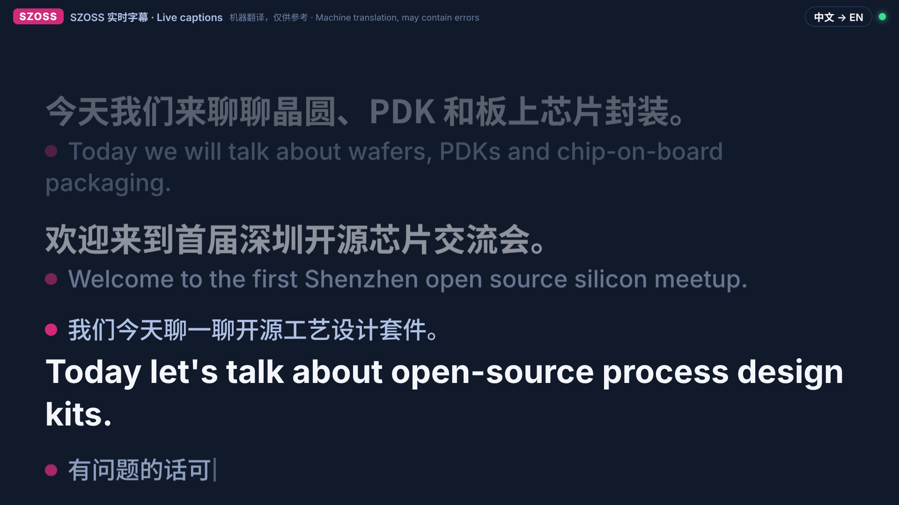
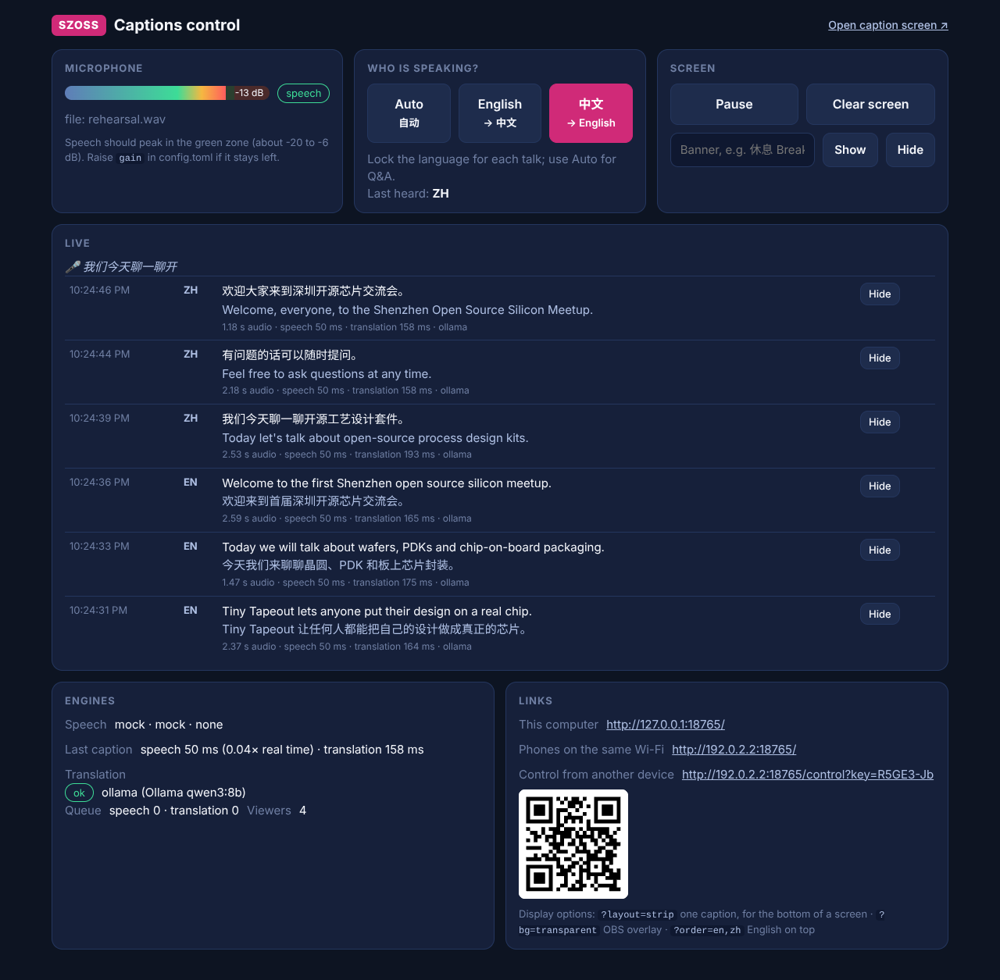

# SZOSS live captions

Live English ⇄ Mandarin captions for talks. A microphone feed goes in; a screen shows what was said in both languages, a second or two after each phrase.



- **Speech recognition:** Whisper, on the laptop. Large-v3-turbo on Apple Silicon (MLX) or an NVIDIA GPU; `small` on CPU-only machines.
- **Translation:** Qwen 3 through Ollama, on the laptop by default, so no internet is needed. DeepSeek or Alibaba's Qwen API can be added as online backups; both work from mainland China without a VPN.
- **Screens:** a caption page for the projector or a TV, an operator page (switch speaker language, pause, show a banner, hide a bad line), and phones on the same Wi-Fi can follow along.
- **Transcript:** every caption is saved to `transcripts/` as text and JSON lines.

## Windows app (no Python needed)

The [Releases page](../../releases/latest) has **SZOSS-Captions-win64.zip**: unzip it and double-click **SZOSS Captions.exe**. It includes Whisper small, a Qwen3 translation model run by llama.cpp (graphics card via Vulkan if available, otherwise CPU), and everything else, so it needs no installs and no internet. Pick the microphone on the control page. The zip's README.txt covers first-run prompts (SmartScreen, firewall, microphone privacy).

It is built and tested on GitHub's Windows machines by `.github/workflows/build-windows.yml` (see `packaging/build_windows.py`): every push to `main` produces a new release after the packaged app has captioned and translated real English and Chinese speech.

## Do this before you travel

Hugging Face, where the Whisper models live, is blocked in mainland China, and multi-GB downloads on venue Wi-Fi are no fun. On the laptop you'll use at the event:

1. Install (below).
2. `python captions.py download`: fetches the Whisper model into `models/` and pulls the Ollama translation model.
3. `python captions.py check`: say a sentence in English, run it again and say one in Chinese. It prints what it heard, the translation, and whether the laptop is fast enough.
4. Rehearse with a recording of a talk: `python captions.py --file talk.mp4 --open`.

If you have to download in China anyway: `HF_ENDPOINT=https://hf-mirror.com python captions.py download`, and `pip install -i https://pypi.tuna.tsinghua.edu.cn/simple -r requirements.txt`.

## Install

**Mac.** Apple Silicon is the best fit.
1. Python 3.11 or newer: `brew install python@3.12`, or the installer from python.org.
2. Ollama from https://ollama.com. Open it once so it runs in the menu bar.
3. In this folder: `./setup.sh`. It creates `.venv`, installs everything and runs the download step.
4. The first time it listens, macOS asks whether Terminal may use the microphone. Allow it (System Settings → Privacy & Security → Microphone).

**Windows.**
1. Python 3.11 or newer from python.org (tick "Add python.exe to PATH").
2. Ollama for Windows from https://ollama.com.
3. Double-click `setup.bat`.
4. NVIDIA GPU: faster-whisper needs the CUDA 12 cuBLAS and cuDNN 9 libraries (see the faster-whisper README). Without them it runs on the CPU.

**Linux:** as for Mac, plus `sudo apt install libportaudio2`.

### Which laptop

| Laptop | Speech model (auto) | Translation | Notes |
| --- | --- | --- | --- |
| Apple Silicon, 16 GB+ | MLX large-v3-turbo | `qwen3:8b` | Best option |
| Apple Silicon, 8 GB | MLX large-v3-turbo | `qwen3:4b`, or online | Set `model = "qwen3:4b"` |
| Windows/Linux + NVIDIA | large-v3-turbo on CUDA | `qwen3:8b` | Needs the CUDA libraries |
| CPU only | `small` | Online (DeepSeek / Qwen) | Fine for English; Chinese accuracy drops. Try `medium` if `check` says it's fast enough |

## Running it

```
./start.command          # Mac (double-click works too)
start.bat                # Windows
python captions.py       # anywhere, with .venv activated
```

It loads the models, then prints the addresses:

- **Caption screen:** http://127.0.0.1:8765. Drag it to the projector or TV and press **F** for full screen.
- **Control page:** http://127.0.0.1:8765/control



### On the day

**Audio matters most.** Take a feed from the venue's mixer (an aux or record output into a USB audio interface), or plug a wireless mic receiver into the laptop. A laptop's built-in mic picking up the PA and room echo will give poor results. Check the level meter on the control page: speech should peak in the green zone. `python captions.py devices` lists the inputs; put the right one in `config.toml` under `[audio]`.

**Lock the language for each talk.** Before a talk starts, press **E** (English speaker, captions translated into Chinese) or **C** (Chinese speaker, translated into English) on the caption screen, or use the buttons on the control page. It's more reliable than auto-detect. Switch to **A** (auto) for Q&A and panels, where it detects English or Mandarin per sentence and leans towards the current speaker's language.

**Between talks:** **Space** pauses, **X** clears the screen, and the control page can show a banner such as "休息 Break · back at 16:30". A caption you don't want on screen can be hidden from the control page.

**Where the captions go:**
- A second screen or TV next to the slides: the default layout.
- One strip under the slides: http://127.0.0.1:8765/?layout=strip
- In OBS for a stream or recording: add a Browser Source with `http://127.0.0.1:8765/?layout=strip&bg=transparent`.
- Phones: press **Q** on the caption screen for a QR code to the page. This only works if the venue Wi-Fi lets devices see each other. WeChat's scanner can refuse a bare IP address; the phone's camera and normal browser work.

### Caption screen keys

| Key | |
| --- | --- |
| A / E / C | Auto-detect / English speaker / Chinese speaker |
| Space | Pause or resume |
| X | Clear the screen |
| + / − | Text size (remembered by the browser) |
| F | Full screen |
| H | Hide or show the top bar |
| Q | QR code for phones |
| ? | Help |

URL options for the caption page: `layout=strip`, `bg=transparent`, `order=en,zh` (English line on top), `lines=2`, `header=0`.

The language, pause and clear keys only work on the laptop running the program. To control it from another device, use the "Remote control" link printed at startup (it carries a key).

## Translation backends

Set in `config.toml` under `[translation]`. Backends in `order` are tried in turn; one that fails twice is skipped for 30 seconds, so a dead connection doesn't slow every caption.

- `ollama` (default): runs on the laptop, no internet. `qwen3:8b` handles English ⇄ Chinese well; `qwen3:4b` on smaller machines.
- `deepseek`: needs internet and an API key from platform.deepseek.com. Set `DEEPSEEK_API_KEY` in the environment, then e.g. `order = ["ollama", "deepseek"]`.
- `qwen`: Alibaba Model Studio. `qwen-mt-flash` is a dedicated translation model. Set `DASHSCOPE_API_KEY`, and the base URL for your account's region.

If the laptop struggles running Whisper and the translator together, put an online backend first: `order = ["deepseek", "ollama"]`. Captions are a sentence at a time, so an afternoon costs very little. Anthropic, OpenAI and Google APIs aren't preconfigured because they aren't reachable from mainland China without a VPN; any OpenAI-compatible endpoint can be added as `type = "openai"`.

`python captions.py --no-translate` gives captions in the spoken language only.

## Tuning

- **Names and terms:** `[glossary]` in `config.toml` fixes translations in both directions (map a name to itself to keep it in English). `prompt_en` / `prompt_zh` help Whisper spell names it will hear.
- **Too slow** (`check` reports more than 0.5× real time, or captions lag): use a smaller model (`asr.model = "small"` or `"base"`), `beam_size = 1`, and turn off the live grey line (`partial_interval_s = 0`). The live line switches itself off if it can't keep up.
- **Sentences cut in half:** raise `end_silence_ms` to 800–900.
- **Noise makes captions:** raise `vad_threshold` to 0.6–0.7.
- **Too quiet:** raise `audio.gain`.

## How it works

```
mic ─▶ Silero VAD ─▶ Whisper ─▶ translator ─▶ web pages (Server-Sent Events)
       cuts at       English or    LLM with glossary     caption screen, control page, phones
       pauses        Mandarin      + recent sentences    + transcripts/
```

- Speech is split at pauses (or after 12 seconds at the quietest moment). While someone is talking, a grey line shows the words so far; the translation appears when they pause.
- Whisper's language detection is limited to English and Mandarin (Cantonese counts as Chinese), and only switches away from the current speaker's language on strong evidence.
- Chinese output is converted to Simplified characters and mainland vocabulary. Common Whisper hallucinations on silence ("Thanks for watching", "字幕由…") are dropped.
- The translator gets the last few sentences as context and the glossary terms that occur in the sentence.

## Troubleshooting

- **Meter doesn't move:** wrong input. Run `python captions.py devices` and set `audio.device`. On a Mac, check the microphone permission for Terminal.
- **"translation unavailable" on screen:** the Engines card on the control page shows the error. For Ollama, check it's running (`ollama list`).
- **Model download fails:** see "Do this before you travel".
- **Port already in use:** `python captions.py --port 8766`.
- **"PortAudio library not found":** Linux only, `sudo apt install libportaudio2`.

## Files

- `captions.py`: the program (`run`, `devices`, `check`, `download`).
- `config.toml`: settings.
- `livecaptions/`: the code; `livecaptions/web/` holds the two pages.
- `models/`: downloaded Whisper models (created by `download`).
- `transcripts/`: one `.txt` and one `.jsonl` per run.
